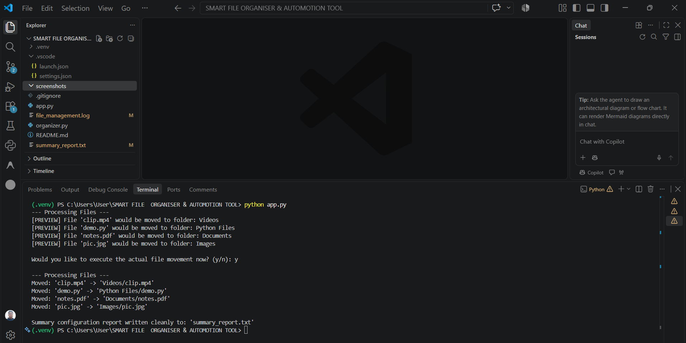
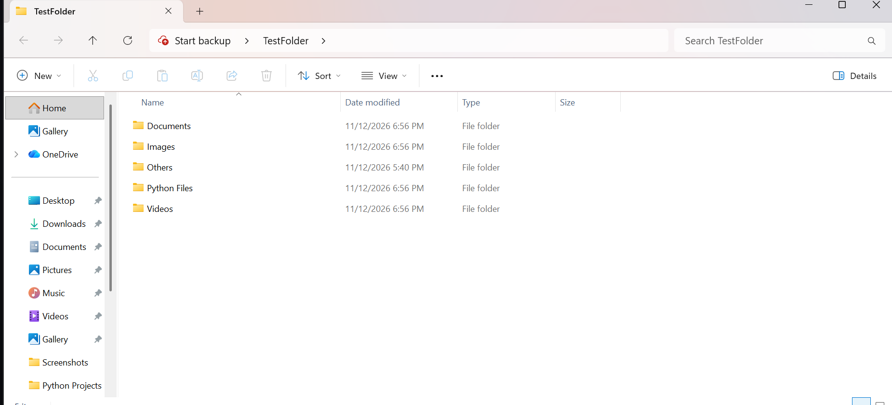
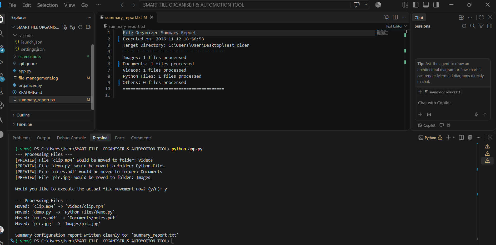

# Smart File Organizer & Automation Tool

A Python command-line tool built using Object-Oriented Programming (OOP) to sort messy directories. It scans a folder provided by the user, categorizes files based on their extensions, prevents overwriting duplicate files, and keeps a record of all moved files.

## Features
- **OOP Design:** The core logic is organized inside a `FileOrganizer` class in `organizer.py`.
- **Automatic Sorting:** Scans files using Python's `os` module and moves them into five folders:
  - **Images:** `.jpg`, `.jpeg`, `.png`
  - **Documents:** `.pdf`, `.docx`, `.txt`
  - **Videos:** `.mp4`, `.mkv`
  - **Python Files:** `.py`
  - **Others:** Any other file types
- **Auto Folder Creation:** Creates missing category folders automatically when needed.
- **Duplicate File Handling:** Checks if a file with the same name already exists in the destination folder. If it does, the script renames the new file (for example, `photo_1.jpg`) instead of replacing the existing one.
- **Preview Mode:** Lets you see where files will be moved before making any real changes to your folder.
- **Report & Activity Log:** Saves a category-wise count in `summary_report.txt` and logs every file movement with timestamps in `file_management.log`.

## Project Structure
```text
├── .vscode/             # VS Code workspace settings
├── screenshots/         # Screenshots of the tool in action
├── app.py               # Main script to run the program
├── organizer.py         # Contains the FileOrganizer class
├── file_management.log  # Log file of moved files
├── summary_report.txt   # Summary report of sorted files
└── README.md            # Project documentation
```

## Installation & Setup

1. **Clone this repository:**
   ```bash
   git clone https://github.com
   cd Smart-File-Organizer-Automation-Tool
   ```

2. **Create and activate a virtual environment (Optional):**
   Make sure Python 3.x is installed on your system.
   ```bash
   python -m venv .venv
   
   # On Windows (PowerShell):
   .venv\Scripts\Activate.ps1
   
   # On macOS/Linux:
   source .venv/bin/activate
   ```
   *(This tool uses Python's built-in `os`, `shutil`, `logging`, and `datetime` modules, so no extra packages need to be installed.)*

## Safe Testing Guide
To test the script safely without affecting your personal `Downloads` folder:

1. Create a temporary folder on your Desktop (for example, `TestFolder`).
2. Put a few sample files inside it with different extensions (such as `pic.jpg`, `notes.pdf`, `sample.txt`, `clip.mp4`, `demo.py`, and `archive.zip`).
3. To check duplicate handling, place another file with the exact same name (like another `pic.jpg`) into the test folder and run the tool again.

## How to Run

1. Open your terminal in the project folder and run:
   ```bash
   python app.py
   ```
2. Enter the **absolute path** of the folder you want to organize (e.g., `C:\Users\User\Desktop\TestFolder`).
3. Type `y` if you want to preview the file movements first, or `n` to sort the files directly.
4. Check `summary_report.txt` and `file_management.log` in the project directory to review the results.

## Screenshots

Here are a few screenshots showing the tool running on a test folder:

**1. Running the script and previewing file movements:**


**2. Organized folders created inside the target directory:**


**3. Generated summary report:**


Built as part of the Advanced Python With Freelancing course to practice file automation and OOP.